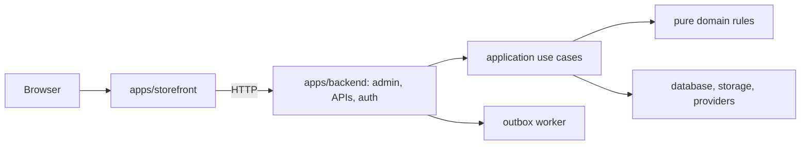

# First contribution

Supastore is a self-hosted storefront and merchant admin for one independent
business per deployment. It is a developer beta, with production acceptance and
an observed merchant pilot still open.

## Try the product

Install Node >=22.13.0 and Docker Compose, clone the repository, then run:

```bash
node scripts/demo.mjs
```

The isolated Docker demo builds dependencies inside containers, provisions its
own database/storage, applies migrations and seeds synthetic products and an
owner. It does not read the root `.env` or use the configured store's volumes.
New checkouts generate separate Compose project names so they do not share demo
volumes. Older demo settings retain their original project and data.
The first build can take several minutes. Open `http://localhost:3080/en` and
`http://localhost:3080/admin`. The synthetic login is `owner@example.test` /
`DemoStorePassword123!`. External notifications and payments are disabled.

Configuration and generated infrastructure credentials live in the ignored
`.supastore-demo/settings.env`. Change `DEMO_PORT`/`DEMO_STORAGE_PORT` there if
3080/3090 are occupied, then rerun the command. Only loopback ports are published.
Keep this file while retaining demo volumes; regenerating credentials does not
change passwords already stored in those volumes.
Do not expose this demo to a public network or reuse its owner password.

Use `node scripts/demo.mjs status` or `node scripts/demo.mjs logs` for diagnosis.
Run `node scripts/test-demo.mjs` to check readiness, seeded products and synthetic
owner access; this same dependency-free HTTP check runs in CI.
`node scripts/demo.mjs down` stops the demo and preserves its data. Never point
the demo tooling at a real merchant database. Demo setup is not a production
installer; use the [operator cookbook](operator-cookbook.md) for real deployment.

## Find the code



Shared packages contain HTTP contracts, localization, shipping helpers and UI
primitives. Customer code must not import backend business logic or secrets.
Routes authenticate and validate inputs; use cases coordinate transactions;
domain modules calculate rules without database or environment dependencies.
Read the relevant directory README, then its tests, before editing.

## Make a change

1. Install the pinned pnpm 11.0.9 and run `pnpm install --frozen-lockfile`.
2. Select a bounded task from [starter contributions](starter-contributions.md)
   or propose one through a GitHub issue. Check for an existing owner first.
3. Reproduce the problem with a meaningful test; preserve existing behavior.
4. Run `pnpm typecheck`, `pnpm lint`, `pnpm format:check` and affected tests.
   `pnpm test` covers shared/backend units; `pnpm test:storefront:unit` covers
   storefront helpers. See [commands](commands.md) for database/browser suites.
5. Open a PR describing the result and checks actually run. Explain migration
   and operational effects when relevant. Report vulnerabilities through
   [private reporting](../SECURITY.md), not public issues.
