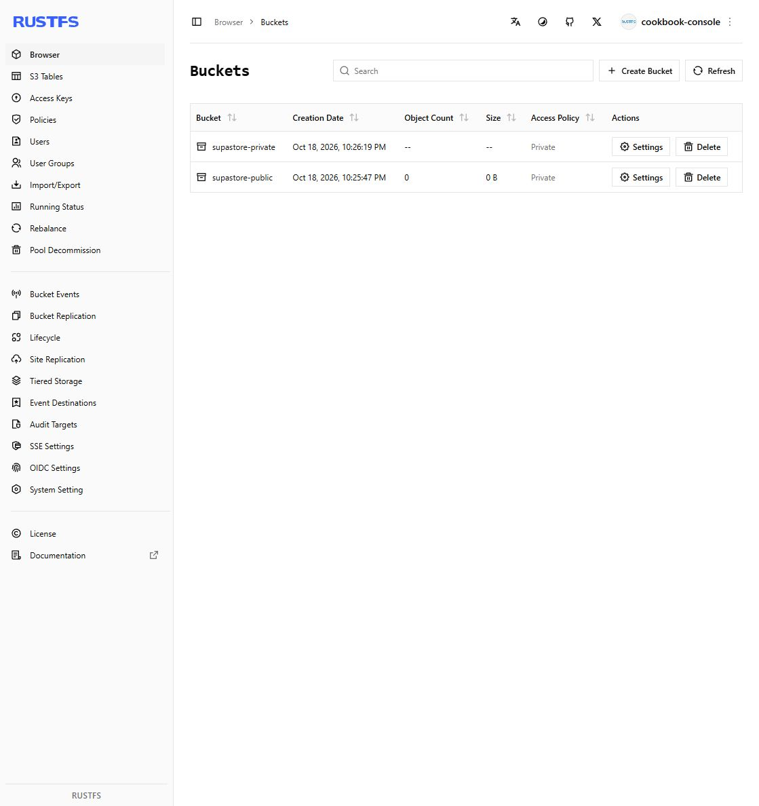
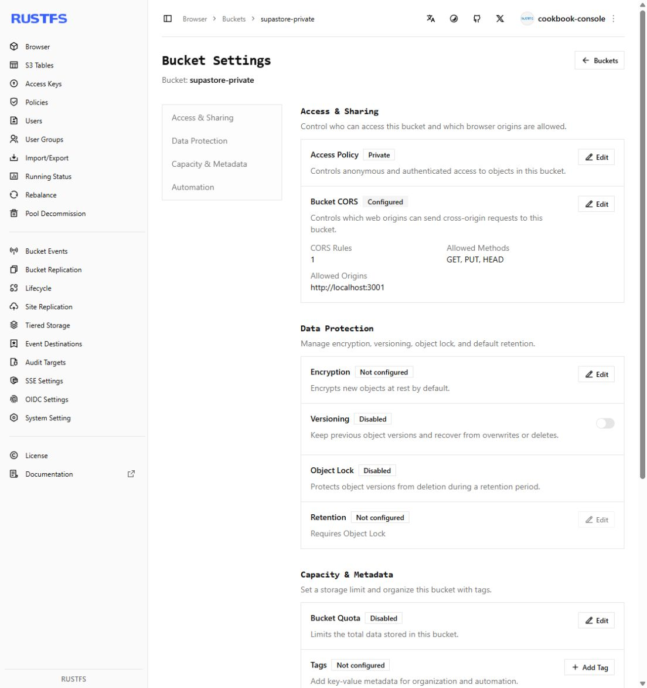

# Clean installation and storage console acceptance

Recorded October 19, 2026, America/Los_Angeles; the local rehearsals began
October 18. This closes the Linux clean-install and RustFS-console gaps from
the [cookbook rehearsal](cookbook-acceptance-2026-10-18.md). Production and human
acceptance remain separately tracked below.

## Clean checkout and dependencies

Created an unmodified local Git clone without environment files or
`node_modules`. An uncached Docker build used the repository-pinned Node 22
Alpine base and pnpm **11.0.9**, executing `pnpm install --frozen-lockfile`.
The installer downloaded **678 packages with zero reused packages** and completed
allowed native dependency installation scripts. The lockfile was not changed.

Verification used Node **22.23.3**, the clean checkout at `ec2fd5d`, and those
freshly installed dependencies:

- `pnpm run typecheck`: root, backend and storefront all pass.
- `pnpm run test:unit`: **1,176 passed**, 134 files.
- `pnpm run test:storefront:unit`: **92 passed**, 18 files.

The first verification-only Docker context inherited production exclusions for
tests/Compose files and lacked Bash. The verification context was corrected to
include the full test source and Bash; production Docker exclusions are unchanged.
The full unit run also exposed three old route fixtures that assumed recovery
redirects used the request host. The reviewed test-only correction explicitly
configures the public origin and sends internal-host requests. Cookie/error
assertions remain intact. The clean clone was updated to that committed
correction before the passing full run.

The command reference now uses `pnpm exec vitest run <file>` for focused unit
selection: adding a file argument to `test:unit` still selects its existing whole
`tests/unit` filter. No application behavior changed in this follow-up.

This establishes the pinned Linux installation path. It does not establish a
native Windows production build, a fresh browser-runtime download, production
provider connectivity or target-host recovery.

## RustFS console and access

Used the exact RustFS image digest from repository Compose:
`sha256:1803faef57627e2d9c2e7d89d655d712ddded5389040054987163043fecb6a3c`.
A separate project exposed only loopback fixture ports 9007/9008 for API/console,
with synthetic credentials and a disposable volume.

Through the console UI, signed in with the existing storage credentials,
created `supastore-public` and `supastore-private`, and verified **Private** access
for both. Configured the evidence bucket through **Settings → Edit Bucket CORS**
with origin `http://localhost:3001` and methods `GET, PUT, HEAD`.





Independent S3/HTTP checks confirm the UI-created configuration:

| Check                                     | Result                          |
| ----------------------------------------- | ------------------------------- |
| Bucket names                              | Both expected names present     |
| Signed private object GET                 | HTTP 200                        |
| Anonymous private object GET              | HTTP 403                        |
| Preflight from the configured storefront  | HTTP 200; exact allowed origin  |
| Preflight from an unlisted example origin | No matching allow-origin header |

The [cookbook](operator-cookbook.md#rustfs-console-setup) now documents the
observed controls and CORS JSON. No public bucket policy, new credentials or
production storage were introduced.

## Cleanup and retained evidence

The verified clean clone was removed after recording its revision and clean
status. This also prevents nested clone tests being discovered by root Vitest.
Local logs/results remain under `.tmp-cuj/launch-gap/`; separately tagged
installation/verification images are retained. The temporary console tab was
closed. Storage fixture cleanup is recorded after the Docker daemon is available.
The daemon was unavailable when removal was attempted after the session resumed;
the Docker Desktop start/status requests did not restore its API. Removal of the
`supastore-gap-storage-20261018` project and its disposable volume is therefore
**not yet confirmed**. When Docker is available, remove only this named fixture:

```bash
docker compose --env-file .tmp-cuj/launch-gap/empty.env -p supastore-gap-storage-20261018 -f .tmp-cuj/launch-gap/storage.json down --volumes
```

The fixture configuration is retained in that ignored workspace. Confirm empty
project-label container, volume and network inventories afterward; this command
is not a production-store cleanup procedure.

## Gates requiring external participation

The [production worksheet](launch-acceptance.md) is ready but **not run**: no
target host/domain, bounded live transaction/refund scope or approved email
recipient has been supplied for this run. Prior local and earlier separately
approved provider evidence does not prove the selected production release.

The [human merchant pilot](merchant-pilot.md) includes a participant task script,
observation/results sheet, pass criteria and retest process. It is **not run**
until a human participant and observer complete it. The roadmap's pilot item
remains open. An agent simulation cannot close that gate.
