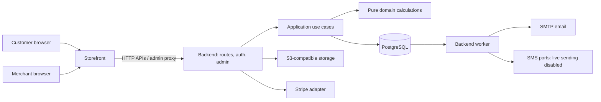

# Current system capabilities

Snapshot: 2026-10-09. This is a maintenance-oriented inventory of the checked-in implementation, starting from the [README](../README.md), source, tests, specifications, and dated implementation evidence. It is not production deployment approval. Test results linked here were recorded by their respective documents; they were not rerun for this documentation change.

## Reading path

For the complete actor-based inventory, use the [user journey index](critical-user-journeys.md). Its stable IDs link acceptance outcomes to [detailed workflows](business-workflows.md) and existing test sources, with manual verification gaps explicitly identified. This capability document owns implemented/deferred boundaries rather than duplicating journey steps. Coverage references are not current pass results.

1. Read this summary for supported behavior and boundaries.
2. Use the directory READMEs under [backend source](../apps/backend/src/README.md), [applications](../apps/README.md), and [shared packages](../packages/README.md) for implementation, storage, interfaces, and regression checks.
3. Use the [maintenance guide](system-maintenance.md) for changes, diagnosis, configuration, upgrades, and recovery.
4. Consult the owning contracts for exact financial and business rules: [workflows](business-workflows.md), [transactions](transaction-contracts.md), [schema](database-schema.md), and [events](api-events-spec.md).

Specifications describe intended rules; code establishes what is implemented; tests and dated evidence establish what was exercised. A planned milestone or existing adapter does not establish production acceptance. When these disagree, investigate and update the owner document before changing behavior.

## System summary

Supastore is a self-hosted physical-goods commerce system for one merchant business, one currency, and one stock pool per variant. It provides customer shopping, merchant administration, financial reconciliation, fulfillment, and durable notifications without Redis or an external message broker.

There are two independently buildable Next.js applications. Backend implementation lives in `apps/backend/src/` and owns admin, authentication, APIs, PostgreSQL transactions, storage access, provider secrets, and the worker. `apps/storefront` renders customer pages through backend HTTP APIs and proxies browser API traffic. The original customer pages live in `apps/storefront`; the backend route tree contains admin and APIs. This source-location correction was checked on 2026-10-15; it does not refresh the dated test results below.

The stack uses Next.js 15, React 19, TypeScript, Valibot, Drizzle, postgres.js, Better Auth, S3-compatible storage, and Nodemailer. Exact installed versions belong to the lockfile. Root `pnpm dev` starts both services; separate development uses `pnpm dev:backend` and `pnpm dev:storefront`. Docker builds backend, storefront, and a one-shot migration image.

## Capability inventory

“Implemented” means source and interfaces exist, with corresponding automated coverage where referenced. It does not mean a real merchant deployment or live provider acceptance has been completed.

| Area                   | Current capability                                                                                                                                                                                | Boundaries and operational conditions                                                                                                                                                                                                                                                                                                                                                              |
| ---------------------- | ------------------------------------------------------------------------------------------------------------------------------------------------------------------------------------------------- | -------------------------------------------------------------------------------------------------------------------------------------------------------------------------------------------------------------------------------------------------------------------------------------------------------------------------------------------------------------------------------------------------- |
| Store setup            | Owner setup, email verification, launch-readiness checks, currency/timezone, contact and branding/content settings, pause ordering                                                                | Pausing blocks new purchases while preserving catalog browsing and existing-order operations. Currency locks after the first order, including free orders.                                                                                                                                                                                                                                         |
| Staff                  | Owner/staff memberships, active-membership verification, governance and owner recovery                                                                                                            | Admin users are created through trusted terminal commands; the UI manages existing memberships and has no add/invite flow. Sensitive owner actions use explicit role checks; customer registration grants no staff access.                                                                                                                                                                         |
| Catalog                | Products, categories, collections, reusable attributes/options, combinations/SKUs, bulk variant updates, specifications, media and translations                                                   | One stock pool per variant; no multiwarehouse model. Product history and accepted purchase snapshots must survive later edits.                                                                                                                                                                                                                                                                     |
| Merchandising          | Store content/navigation/policies, product organization, discounts/promotions, product availability                                                                                               | Main and separate storefront route coverage differs; see the owning application READMEs. No theme marketplace or generic plugin framework.                                                                                                                                                                                                                                                         |
| Customer identity      | Registration, verification, login, profile, address book, password change/reset, owned order history and exact-reference search                                                                   | Customer email change and wallet top-up self-service are deferred. Guest-order claiming requires private access proof as well as verified identity.                                                                                                                                                                                                                                                |
| Guest access           | Guest cart/session, private order access, emailed recovery-link exchange                                                                                                                          | Matching an email or knowing an order reference never transfers ownership. Guest checkout is merchant configurable.                                                                                                                                                                                                                                                                                |
| Checkout               | Persistent cart, backend quote, price/terms review, quantity and destination validation, saved addresses, mixed credit/external funding                                                           | Quote acceptance revalidates authoritative state. Money is requested after order creation. One fulfillment method per order.                                                                                                                                                                                                                                                                       |
| Order management       | Idempotent placement, immutable purchase snapshots, free-order confirmation, manual orders, receipt review, confirmation, cancellation and restricted pre-receipt proposals                       | Manual entry supports shipping and local pickup with configured location/scheduling rules, uses entered contact details and shows the calculated total after creation; no existing-customer picker or pre-submit total review. Customer cancellation/amendments/rescheduling and declining changes remain support managed. Paid/taxable/reward-bearing repricing can require replacement checkout. |
| Manual payments        | Receiving accounts, evidence uploads, actual bank/cash receipts, correction cases, cash reconciliation                                                                                            | Evidence is not a receipt. Staff records actual movements; installments are not offered. Manual review deadlines do not automatically release reservations.                                                                                                                                                                                                                                        |
| Card payments          | Stripe hosted checkout, durable verified callbacks, provider reconciliation/expiry, original-source refunds                                                                                       | Redirect success is not settlement. Live Stripe configuration and receipt acceptance remain external release checks. Unsupported provider currency units fall back to manual methods.                                                                                                                                                                                                              |
| Inventory              | Counted variant stock, placement reservations, consumption at dispatch/handoff, cancellation release, shortage and pending-review views                                                           | Variants can remain untracked until counted. Downward counts cannot silently erase reserved obligations.                                                                                                                                                                                                                                                                                           |
| Fulfillment            | Shipping, pickup, local delivery, multiple configured pickup locations, schedules/blackouts/preparation time, slot capacity and variant quotas, staff rescheduling                                | A method must be enabled and configured. Scheduling is optional for pickup/local delivery. No automatic carrier rate or label integration.                                                                                                                                                                                                                                                         |
| Regional shipping      | Flat zones, free-shipping threshold, country/region/postal-prefix filters and deterministic priority                                                                                              | Prefixes are literal, not ranges/wildcards. Unmatched destinations require a configured fallback or are rejected.                                                                                                                                                                                                                                                                                  |
| Shipment tracking      | Quantity-based partial shipments, dispatch, recorded delivery, tracking updates, signed carrier gateway callbacks                                                                                 | Dispatch is distinct from delivery; completion waits for every unit. The gateway needs configured credentials; it is not a general carrier integration.                                                                                                                                                                                                                                            |
| Refunds and returns    | Purchase refund authorization, excess/late-payment returns, physical-goods requests/approval/receipt, payout claims and reconciliation                                                            | A goods-return request is not refund approval. Original funding source, component caps, verified destination, and unresolved-payout holds govern payment.                                                                                                                                                                                                                                          |
| Store credit           | Customer credit ledger, available/reserved balances, source lots, reservations/capture, capped compensating refunds                                                                               | Credit is funding, not a discount or synthetic external receipt. Unreconciled credit is excluded from spendable balance. Transfers and wallet top-up self-service are deferred.                                                                                                                                                                                                                    |
| Rewards                | Opt-in configured rate, category eligibility/product exclusion, UTC activation interval, immutable policy/funding snapshots, release after completion, refund reversal/debt and review resolution | Defaults off. Eligible discounted merchandise earns on settled external funding; tax, fees, and credit-funded amounts do not earn. No invented historical reward backfill.                                                                                                                                                                                                                         |
| Reports and data tools | Sales/fiscal-year reporting, outside-sales adjustments, threshold alerts, product CSV import/export, order CSV/XLSX export, credit-ledger export                                                  | Sales refunds and payout activity are distinct. Order import and general round-trip data import are outside current scope.                                                                                                                                                                                                                                                                         |
| Email                  | Verification/reset/store proof and transactional notifications, SMTP password/relay and Gmail OAuth adapters                                                                                      | SMTP acceptance does not establish inbox delivery. Provider changes/retries preserve prepared delivery identity.                                                                                                                                                                                                                                                                                   |
| Notification templates | Owner draft/preview/publish/history/rollback, bilingual email/SMS defaults, completeness and unsent-template-review repair                                                                        | Migration 0036 seeds 68 combinations. Simple allowed variables only; previews send nothing. Published versions and prepared retries are immutable.                                                                                                                                                                                                                                                 |
| SMS/phone verification | Provider-neutral ports, Telnyx adapters, consent/preferences, verification fencing, durable signed callbacks                                                                                      | Live SMS and phone-verification sending remain disabled in the composition root. Fake-provider tests do not authorize live sending.                                                                                                                                                                                                                                                                |
| Operations             | Health routes, structured logging, bounded worker leases/retries, housekeeping, migration/container/recovery tooling, SEO and optional consent-based analytics                                    | Real provider delivery, trusted ingress, production restore rehearsal, and hosting/domain cutover require deployment-specific acceptance.                                                                                                                                                                                                                                                          |

## Key end-to-end workflows

### Purchase and fulfillment

Browse → select variants → owned cart → server quote → accept current terms → create one unpaid order → show private tracking/payment instructions. Placement reserves stock, optional slot capacity, and requested spendable credit atomically. Free orders can confirm during placement when fulfillment remains valid.

For manual payment, upload evidence if required and have staff record actual funds. For Stripe, reconcile signed durable provider evidence. Confirmation captures funding and checks exact purchase coverage and relevant holds. Prepare → dispatch shipping/local delivery or verify pickup handoff → record delivery for all units → complete order and release eligible reward credit.

Accepted orders retain product, amount, address, fulfillment, locale, and reward terms independently of future catalog/profile/configuration changes. Financial correction and refund work can continue after lifecycle completion/cancellation.

### Returns and money reconciliation

Physical goods: authorized customer requests return → staff/owner reviews → record approved quantities and goods receipt → authorize the appropriate purchase refund → settle through credit compensation or original external source. Do not treat a return status alone as proof of outgoing money.

External funds: retain receipt history → calculate available original-source entitlement → authorize allocation → persist exclusive payout claim → send outside the database transaction → reconcile physical evidence. Unknown outcomes retain holds; they never trigger an automatic replacement transfer. Receipt corrections and wrong-destination/over-disbursement evidence require audited review rather than rewriting settled history.

### Notifications

A business transaction commits event/audit data with its state change. The backend worker resolves the published template and pins content/provider identity before I/O. Durable attempts, leases, callbacks, retry/review outcomes, and immutable results preserve what actually happened. Authentication messages also use published templates, but follow their authentication send/error paths rather than assuming every email is dispatched by the outbox.

## Fixed boundaries and deferred work

Current boundaries include physical goods, a single merchant/currency, one stock pool, one fulfillment method per order, manual reconciliation plus the Stripe adapter, English/Simplified Chinese, and narrow transport interfaces.

Multi-business/multi-currency commerce, multiple warehouses, subscriptions, digital goods, marketplaces, arbitrary workflow/plugin builders, carrier labels/calculated rates, reward transfers/expiry/backfill, installment schedules, customer self-service email changes/top-ups, and general order import remain outside current implementation scope. Receipt reassignment to a different receiving account remains deferred; owner investigation is required.

## Evidence and documentation drift

The [2026-10-09 journey update](storefront-customer-journey-updates-2026-10-09.md) records 651 fast tests, 83 integration tests, and nine selected production-browser journeys. [Two-service deployment](two-service-deployment.md) separately records ten default cross-service browser tests on that date. These are different selections, not additive totals or a claim about today's test count. Template-specific validation is documented in [template management](notification-template-manager.md); older counts through migration 0034 do not establish coverage of migration 0036.

Historical load/image/bundle results live in [release evidence](generic-store-release-evidence.md) and [local recovery evidence](local-performance-recovery.md). Measurements belong to their tested build/configuration. Resource limits in Compose are configuration, not performance guarantees. `test:coverage` measures the pure domain at 90% thresholds, not the entire application.

Known older wording to interpret with care:

- [Architecture](architecture-overview.md) includes historical frontend implementation descriptions. Inspect actual UI imports before relying on a particular component primitive library.
- The base and extension paragraphs of [transaction contracts](transaction-contracts.md) give different lock summaries. For a change, inspect the shared lock helper and direct locks of every affected writer and resolve the contract discrepancy; do not choose a paragraph as justification for a new lock order.

This snapshot supplements existing contract ownership; it does not silently redefine release policy or financial rules.
